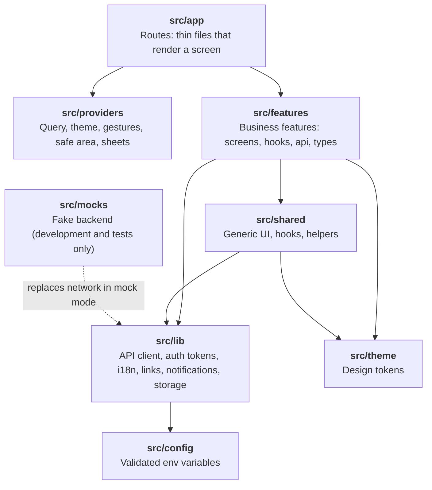
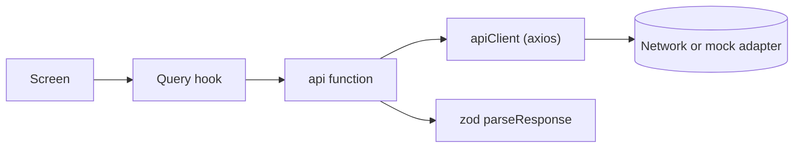
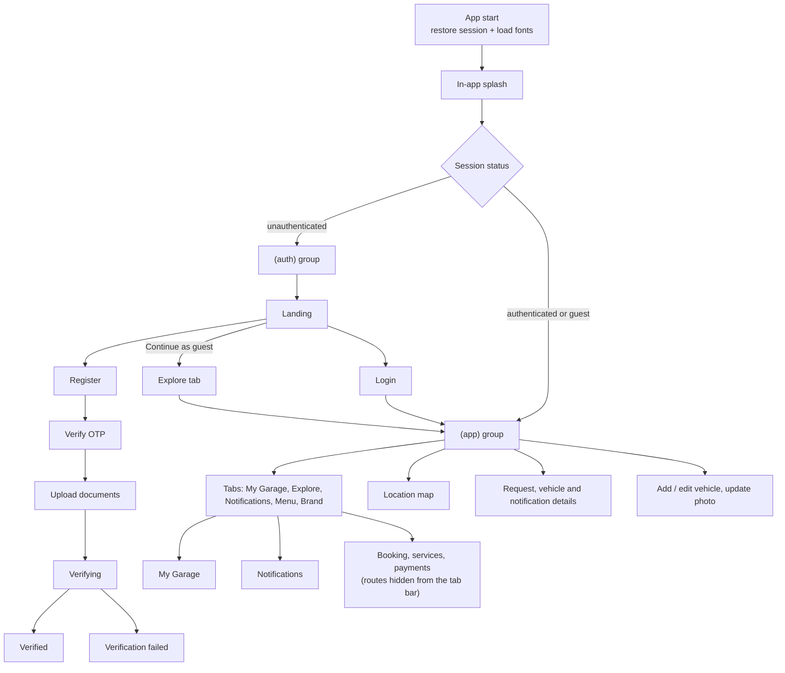
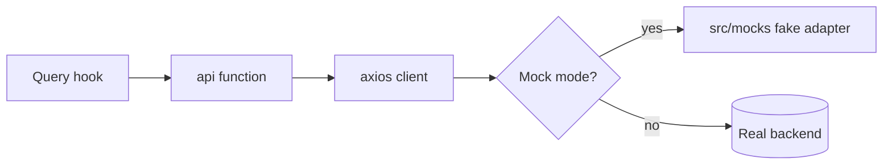
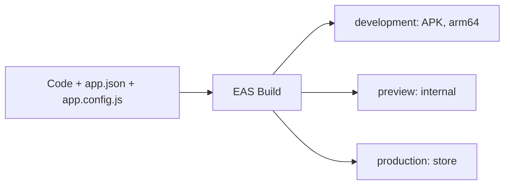
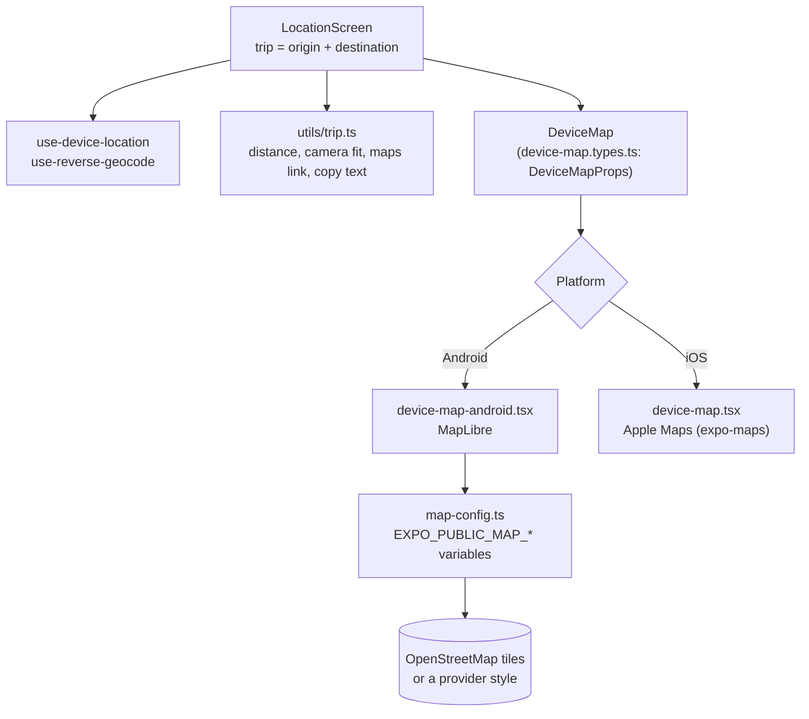
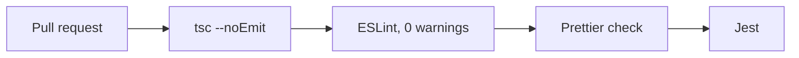

# AutoConnect: Architecture Overview

A presentation-ready summary of how the AutoConnect mobile app is built. For the working rules
behind each area, see [ARCHITECTURE.md](ARCHITECTURE.md) and [CONTRIBUTING.md](../CONTRIBUTING.md).

|                |                                                                                                        |
| -------------- | ------------------------------------------------------------------------------------------------------ |
| **App**        | AutoConnect, a car-owner app: garage, service booking, payments, notifications, maintenance-center map |
| **Platforms**  | Android and iOS (portrait, light theme)                                                                |
| **Identifier** | `com.paralleltech.autoconnect` (Android package and iOS bundle ID)                                     |
| **Backend**    | None yet. A mock API runs inside the app (see [Data and state](#data-and-state))                       |
| **Languages**  | English (LTR) and Arabic (RTL)                                                                         |

---

## 1. Technology stack

Versions are the installed ones, from `package.json` and `node_modules`.

| Area                | Technology                                              | Version               |
| ------------------- | ------------------------------------------------------- | --------------------- |
| Platform            | Expo SDK                                                | 58.0 (`expo` 58.0.26) |
| Runtime             | React Native, React                                     | 0.88.1, 19.3.0        |
| Engine              | Hermes, New Architecture                                | enabled               |
| Language            | TypeScript (strict, `noUncheckedIndexedAccess`)         | 6.0.3                 |
| Routing             | Expo Router (file-based)                                | 58.0.32               |
| Styling             | NativeWind + Tailwind (tokens in `src/theme/tokens.js`) | 4.2.7 / 3.4.19        |
| Server state        | TanStack Query                                          | 5.105.0               |
| Client state        | zustand                                                 | 5.0.16                |
| Validation          | zod (API responses and forms)                           | 4.6.7                 |
| Forms               | react-hook-form                                         | 7.91.0                |
| HTTP                | axios                                                   | 1.21.0                |
| i18n                | i18next + react-i18next                                 | 26.5.12 / 17.1.9      |
| Animation, gestures | Reanimated, Gesture Handler                             | 4.7.1 / 3.3.0         |
| Bottom sheets       | @gorhom/bottom-sheet                                    | 5.2.14                |
| Maps                | MapLibre (Android), Apple Maps via `expo-maps` (iOS)    | 11.5.1 / 58.0.11      |
| Compiler            | React Compiler (enabled in `app.json`)                  | n/a                   |
| Tests               | Jest + React Native Testing Library                     | 30.5.2 / 14.1.0       |

---

## 2. Layers

Dependencies point downward only. ESLint enforces this: `shared`, `lib`, `theme` and `config`
never import a feature or a route, and code outside a feature uses it only through its
`index.ts`.



Inside a feature, data flows one way:



---

## 3. Folder structure

```text
src/
├── app/                  Expo Router routes
│   ├── _layout.tsx         Fonts, session restore, signed-in / signed-out guards
│   ├── +not-found.tsx, +native-intent.ts   Fallback route, incoming link handling
│   ├── (auth)/             Landing, login, register, forgot / reset password, OTP,
│   │                       upload documents, verifying (done / failed)
│   └── (app)/              Signed-in and guest area
│       ├── (tabs)/           My Garage, Explore, Notifications, Menu, Brand
│       │                     (+ hidden services, booking and payment routes)
│       ├── location.tsx      Maintenance-center map
│       ├── add-vehicle.tsx, edit-vehicle.tsx, update-photo.tsx
│       ├── requests/[requestId]
│       ├── vehicles/[vehicleId]
│       └── notifications/[notificationId]
├── features/             One folder per business feature
│   ├── auth/  my-garage/  vehicles/  services/  payments/
│   ├── requests/  notifications/  locations/  profile/  menu/
│   └── <feature>/        index.ts, plus the folders it needs: api/, types/, hooks/, components/,
│                         screens/, utils/, data/, store/ (zustand), schemas/ (form validation)
├── shared/               ui/ (Button, Input, Screen, sheets…), hooks/, utils/, types/
├── lib/                  api/, auth/, i18n/, linking/, notifications/, phone/, query/, storage/
├── providers/            AppProviders, QueryProvider, ThemeProvider
├── theme/                tokens.js (colors, radii, font sizes, fonts)
├── config/               env.ts (validated), support.ts
└── mocks/                Fake backend, one route file per API-backed feature
tests/                  helpers/ (render with providers), fixtures/, mocks/ (native modules),
                        navigation/ (guest entry test)
docs/                   This overview and ARCHITECTURE.md
.github/workflows/      ci.yml
```

---

## 4. Navigation flow

The root layout restores the session and loads fonts, then shows one of two route groups through
`Stack.Protected`. Screens never navigate after login or logout themselves. They only change the
session status.



- **Tab bar:** a custom floating bar. The Brand tab does not open a page. Its tap opens the
  vehicle selector sheet instead.
- **Guests:** "Continue as guest" on the landing page sets the `guest` status. Guests use the
  signed-in routes and start on the Explore tab, so My Garage is never mounted for them.
- **Deep links and push notifications:** only paths in `lib/linking/linking-config.ts` are
  accepted, and IDs are validated. A link opened while signed out is resumed after sign-in.

---

## 5. Data and state

| Concern                 | Where               | How                                                                                                                                           |
| ----------------------- | ------------------- | --------------------------------------------------------------------------------------------------------------------------------------------- |
| Server data             | TanStack Query      | `staleTime` 30 s, `gcTime` 5 min, retry only for recoverable errors, never for mutations                                                      |
| Client state            | zustand             | Small stores only: session status and user, selected vehicle and photos                                                                       |
| Tokens                  | `expo-secure-store` | Never AsyncStorage. A 401 ends the session everywhere                                                                                         |
| Preferences             | AsyncStorage        | Language                                                                                                                                      |
| Validation              | zod                 | Every API response is parsed. Forms use zod schemas                                                                                           |
| Errors                  | `ApiError`          | One `kind` (network, timeout, unauthorized, not_found, validation, server…) and a translated message. `ErrorState` and `FormError` display it |
| Loading and error views | `QueryView`         | Screens describe only the success content                                                                                                     |
| Offline                 | NetInfo             | Queries pause offline and refetch on reconnect. An offline banner is shown                                                                    |

**Mock mode.** With `EXPO_PUBLIC_USE_MOCK_API=true`, `src/mocks/install.ts` replaces the axios
adapter with a fake backend. The real API code, including response validation, still runs.
Metro swaps the mock install for an empty file when the variable is not `true`, so no mock
code ships. Preview and production builds turn it off, and `src/config/env.ts` refuses to start
a production build in mock mode.



Features without endpoints yet (`my-garage`, `services`, `payments`, `locations`, `profile`)
keep their sample content in `data/` folders and do not call the API.

---

## 6. Styling, i18n and RTL

- **One source of design values:** `src/theme/tokens.js` defines colors, radii, border width, font
  sizes and font families. Tailwind generates its classes from it, and font sizes are replaced,
  not extended, so screens can't drift. ESLint rejects hex colors and `[Npx]` values in
  components.
- **Font:** Poppins in three weights, chosen by family name (`font-sans`, `font-sans-medium`,
  `font-sans-semibold`), embedded by the expo-font plugin.
- **Theme:** light only. Navigation headers, tab scenes and screens share the same background token.
- **Shared components:** `src/shared/ui` (Button, Input, Screen, Card, QueryView, OTP input,
  sheets, tab bar…).
- **Languages:** English and Arabic from `lib/i18n/locales`. TypeScript checks both files have the
  same keys, and the translation keys are typed.
- **RTL:** Arabic is mirrored by hand, not with `I18nManager`: screens read
  `i18n.language === 'ar'` and switch to reversed rows and right-aligned text. `useTextAlign`
  covers shared pieces. Dates, numbers and money follow the current language, and the API client
  sends `Accept-Language`. The chosen language is saved and restored at startup.

---

## 7. Environment configuration

Variable names only. Values live in `.env.local` (not committed) and in EAS environment
variables. Anything prefixed `EXPO_PUBLIC_` ships inside the app, so never put secrets there.

| Variable                      | Purpose                                                                      |
| ----------------------------- | ---------------------------------------------------------------------------- |
| `EXPO_PUBLIC_APP_ENV`         | `development`, `preview` or `production` (set by each EAS profile)           |
| `EXPO_PUBLIC_USE_MOCK_API`    | Turns the fake backend on. Forbidden in production                           |
| `EXPO_PUBLIC_API_URL`         | Real backend URL (required when mock mode is off, HTTPS outside development) |
| `EXPO_PUBLIC_LINK_DOMAIN`     | Domain for universal and app links                                           |
| `EXPO_PUBLIC_MAP_STYLE_URL`   | Optional MapLibre style URL                                                  |
| `EXPO_PUBLIC_MAP_TILE_URL`    | Optional raster tile template                                                |
| `EXPO_PUBLIC_MAP_ATTRIBUTION` | Optional map attribution text                                                |

`src/config/env.ts` validates them with zod at startup.

---

## 8. Build and EAS profiles

`app.json` holds the static config. `app.config.js` adds what depends on the build. The
`android/` folder is generated and git-ignored, so native settings change in those two files.

| Profile       | Purpose                                  | Distribution          | Notes                                                                                                                          |
| ------------- | ---------------------------------------- | --------------------- | ------------------------------------------------------------------------------------------------------------------------------ |
| `development` | Dev Client for daily work                | Internal, Android APK | `EXPO_PUBLIC_APP_ENV=development`. Android builds for `arm64-v8a` only to keep the debug APK small. x86 emulators can't run it |
| `preview`     | Internal testing of a release-like build | Internal              | Mock API off. Removes the dev-only `SYSTEM_ALERT_WINDOW` permission                                                            |
| `production`  | Store release                            | Store                 | Mock API off, build number auto-incremented, `SYSTEM_ALERT_WINDOW` removed                                                     |

Identity: Expo owner `mostafahamed`, slug `autoconnect-app`, scheme `autoconnect`.



---

## 9. Native features

| Feature             | Library                                                  | Notes                                                                                                                                                                                                                                                                    |
| ------------------- | -------------------------------------------------------- | ------------------------------------------------------------------------------------------------------------------------------------------------------------------------------------------------------------------------------------------------------------------------ |
| Location            | `expo-location`                                          | Foreground permission only. The position drives the map, the trip, and "Send current location"                                                                                                                                                                           |
| Maps                | MapLibre (Android), Apple Maps through `expo-maps` (iOS) | Android uses OpenStreetMap tiles, so no Google Maps key is needed. `DeviceMap` picks the renderer by platform, and both take the same `DeviceMapProps`. Both map libraries load lazily, so a build without the native module shows "Map unavailable" instead of crashing |
| Push notifications  | `expo-notifications`, `expo-device`                      | Payloads are validated before routing to a screen                                                                                                                                                                                                                        |
| Secure storage      | `expo-secure-store`                                      | Session tokens                                                                                                                                                                                                                                                           |
| Camera and photos   | `expo-image-picker`                                      | Document scan and upload, with editing after capture. Vehicle photos                                                                                                                                                                                                     |
| Clipboard and share | `expo-clipboard`, React Native `Share`                   | Copy address, send location                                                                                                                                                                                                                                              |

How the map screen is put together:



The trip logic (distance, camera fit, Google Maps link, copy text) is pure code in
`features/locations/utils/trip.ts`, covered by unit tests.

---

## 10. Testing and quality gates

- **Suite:** 70 test suites, 459 tests (Jest with the `jest-expo` preset, React Native Testing
  Library). The fake backend also serves the tests, and native modules are mocked in `tests/mocks`.
- **What is covered:** API functions and error mapping, query hooks, the session and auth flows,
  forms and OTP input, the booking and payment screens, deep-link validation, the map screen's
  trip logic, shared UI components, and tab navigation.
- **CI** (`.github/workflows/ci.yml`, Node 22): `npm ci`, typecheck, ESLint with
  `--max-warnings 0`, Prettier check, then the tests. Locally, `npm run check` runs typecheck,
  lint and tests. `npx expo-doctor` currently passes all 20 checks.



---

## 11. Key decisions

| Decision                                                     | Reason                                                                                                                                                            |
| ------------------------------------------------------------ | ----------------------------------------------------------------------------------------------------------------------------------------------------------------- |
| Feature folders, public `index.ts`, lint-enforced boundaries | Features stay independent, and cross-feature use is explicit                                                                                                      |
| NativeWind with tokens                                       | Familiar Tailwind workflow, with a closed set of design values that lint protects. Switching styling libraries would cost a rewrite without fixing a real problem |
| zod on every response                                        | A wrong backend shape fails loudly in one place, and types are inferred, not duplicated                                                                           |
| Server data only in TanStack Query                           | Caching, retry and refetch rules are in one place. zustand holds only client state                                                                                |
| Mock backend replaces the axios adapter, not the API code    | Mock mode runs the same code paths as production                                                                                                                  |
| Manual RTL                                                   | Gives exact control over each screen's mirrored layout without a native restart                                                                                   |
| MapLibre on Android                                          | No Google Maps key or billing, and the tile provider can change with environment variables                                                                        |
| `arm64-v8a` only for development builds                      | Cuts the debug APK size sharply without changing behavior                                                                                                         |

---

## 12. Future improvements

- **Dark mode:** the app is light-only. It needs dual-valued tokens, dark variants, and a design.
- **Shared shadow token:** card and button shadows are repeated inline (location screen, map
  controls). One token would remove them.
- **`useIsRTL` hook:** replaces the repeated `i18n.language === 'ar'` checks in about 40 files.
- **Token refresh:** the refresh flow is not implemented (`TODO(auth)` in `lib/api/client.ts`).
- **Real backend:** connect the API-backed features, and add endpoints for the screens that still
  use sample data.
- **Production map tiles:** the public OpenStreetMap tile server is for development only. Use a
  provider or self-hosted tiles.
- **Production Android size:** build an AAB, and consider R8 and resource shrinking
  (`expo-build-properties`), with release testing. Optionally drop `expo-maps` from Android
  autolinking.
- **Wider screen testing:** more tests for the booking and payment flows and the remaining shared
  components.
- **Unused list component:** `PaginatedList` and `@shopify/flash-list` are ready but not used yet.
  Use them for long lists such as notifications, or remove them.
